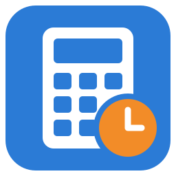
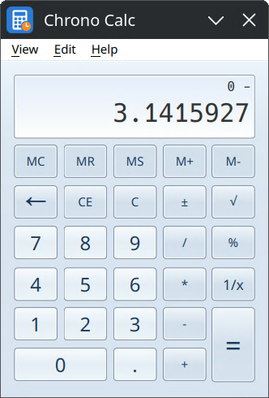

#  <picture><source media="(prefers-color-scheme: dark)" srcset="art/heading-dark.svg"></picture>

The classic desktop calculator, resurrected for Linux.

Chrono Calc brings back the calculator many people know by heart: the same buttons, the same keys, the same results, in a small, quick window. It looks at home on KDE Plasma and works on GNOME as well, on Debian, Ubuntu, Fedora and the Red Hat family.

## What it does

1. **Four views:** Standard, Scientific (with degrees, radians and grads), Programmer (hexadecimal, decimal, octal and binary, with the bits shown) and Statistics.
2. **History:** every calculation is kept in a list; choose one to use its result again, or change it and calculate it again.
3. **Digit grouping:** large numbers shown in groups (1.234.567), the way your regional settings write them.
4. **Unit conversion:** angle, area, energy, length, power, pressure, temperature, time, speed, volume and weight.
5. **Date calculation:** the time between two dates, or a date plus or minus years, months and days.
6. **Worksheets:** mortgage, vehicle lease and fuel economy (mpg and L/100 km).
7. **The keyboard does everything:** every button has its key, and Copy and Paste work as you expect.

Results you can trust: the arithmetic is done by a proven open-source calculation engine that works with numbers of any size.

## Installing

1. Go to the [Releases page](https://github.com/rob-vandenberg/chrono-calc/releases) and download the file for your system:
   1. Ubuntu, Mint, Debian and their family: `chrono-calc_<version>_amd64.deb`
   2. Fedora, Suse, Red Hat and their family: `chrono-calc_<version>_x86_64.rpm`
2. Open the downloaded file. Your software installer (Discover on KDE, Software on GNOME) opens it; choose **Install**.
3. **Chrono Calc** now appears in your application menu. Typing "calc" in the menu's search finds it.

To remove it, find Chrono Calc in Discover or Software and choose **Uninstall**.

## Keyboard

Letters work without Shift. Each view has its own letters; the memory and window keys work everywhere.

<table>
<tr>
<td valign="top">

<table>
<tr><th colspan="2">Basics</th></tr>
<tr><td><code>0</code>–<code>9</code> <code>.</code></td><td>digits</td></tr>
<tr><td><code>+</code> <code>-</code> <code>*</code> <code>/</code></td><td>+ − × ÷</td></tr>
<tr><td><code>Enter</code> <code>=</code></td><td>=</td></tr>
<tr><td><code>Esc</code> <code>Del</code></td><td>C CE</td></tr>
<tr><td><code>Backspace</code></td><td>←</td></tr>
<tr><td><code>F9</code></td><td>±</td></tr>
<tr><td><code>@</code> <code>r</code></td><td>√ 1/x</td></tr>
<tr><td><code>%</code></td><td>%</td></tr>
</table>

<table>
<tr><th colspan="2">Memory</th></tr>
<tr><td><code>Ctrl</code> <code>M</code> <code>R</code></td><td>MS MR</td></tr>
<tr><td><code>Ctrl</code> <code>P</code> <code>Q</code></td><td>M+ M−</td></tr>
<tr><td><code>Ctrl</code> <code>L</code></td><td>MC</td></tr>
</table>

</td>
<td valign="top">

<table>
<tr><th colspan="2">Scientific</th></tr>
<tr><td><code>(</code> <code>)</code></td><td>brackets</td></tr>
<tr><td><code>i</code></td><td>Inv</td></tr>
<tr><td><code>s</code> <code>o</code> <code>t</code></td><td>sin cos tan</td></tr>
<tr><td><code>Ctrl</code> <code>S</code> <code>O</code> <code>T</code></td><td>sinh cosh tanh</td></tr>
<tr><td><code>n</code> <code>l</code></td><td>ln log</td></tr>
<tr><td><code>q</code> <code>#</code> <code>y</code></td><td>x² x³ xʸ</td></tr>
<tr><td><code>Ctrl</code> <code>B</code> <code>Y</code> <code>G</code></td><td>∛x ʸ√x 10ˣ</td></tr>
<tr><td><code>!</code> <code>d</code></td><td>n! Mod</td></tr>
<tr><td><code>;</code> <code>m</code> <code>p</code></td><td>Int dms π</td></tr>
<tr><td><code>v</code> <code>x</code></td><td>F-E Exp</td></tr>
<tr><td><code>F3</code> <code>F4</code> <code>F5</code></td><td>Deg Rad Grad</td></tr>
</table>

</td>
<td valign="top">

<table>
<tr><th colspan="2">Programmer</th></tr>
<tr><td><code>a</code>–<code>f</code></td><td>hex digits</td></tr>
<tr><td><code>&amp;</code> <code>|</code> <code>^</code> <code>~</code></td><td>And Or Xor Not</td></tr>
<tr><td><code>&lt;</code> <code>&gt;</code></td><td>Lsh Rsh</td></tr>
<tr><td><code>j</code> <code>k</code></td><td>RoL RoR</td></tr>
<tr><td><code>%</code></td><td>Mod</td></tr>
<tr><td><code>F5</code>–<code>F8</code></td><td>Hex Dec Oct Bin</td></tr>
<tr><td><code>F12</code> <code>F2</code></td><td>Qword Dword</td></tr>
<tr><td><code>F3</code> <code>F4</code></td><td>Word Byte</td></tr>
</table>

<table>
<tr><th colspan="2">Statistics</th></tr>
<tr><td><code>Enter</code></td><td>Add</td></tr>
<tr><td><code>a</code> <code>s</code> <code>t</code></td><td>x̄ Σx σn</td></tr>
<tr><td><code>Ctrl</code> <code>A</code> <code>S</code> <code>T</code></td><td>x̄² Σx² σn-1</td></tr>
<tr><td><code>d</code></td><td>CAD</td></tr>
<tr><td><code>Del</code></td><td>remove value*</td></tr>
</table>

</td>
</tr>
<tr>
<td colspan="3">

**Window:** `Alt`+`1`–`4` the four views · `Ctrl`+`H` History (`↑` `↓` choose, `F2` edit, `Ctrl`+`Shift`+`D` clear) · `Ctrl`+`U` Unit conversion · `Ctrl`+`E` Date calculation · `Ctrl`+`F4` Basic · `Ctrl`+`C` Copy · `Ctrl`+`V` Paste · `F1` About 
\* In Statistics, click the list first; `F2` edits the chosen value.

</td>
</tr>
</table>

## Credits

The arithmetic is done by the calculator engine that Microsoft published as open source in 2019 ([microsoft/calculator](https://github.com/microsoft/calculator), MIT licence). Chrono Calc is not made by or connected with Microsoft. The engine's licence is installed with the program in `/usr/share/doc/chrono-calc/`.

## Licence

Chrono Calc is free software: you can redistribute it and/or change it under the terms of the GNU Affero General Public License, version 3 or later. See `LICENSE`.
